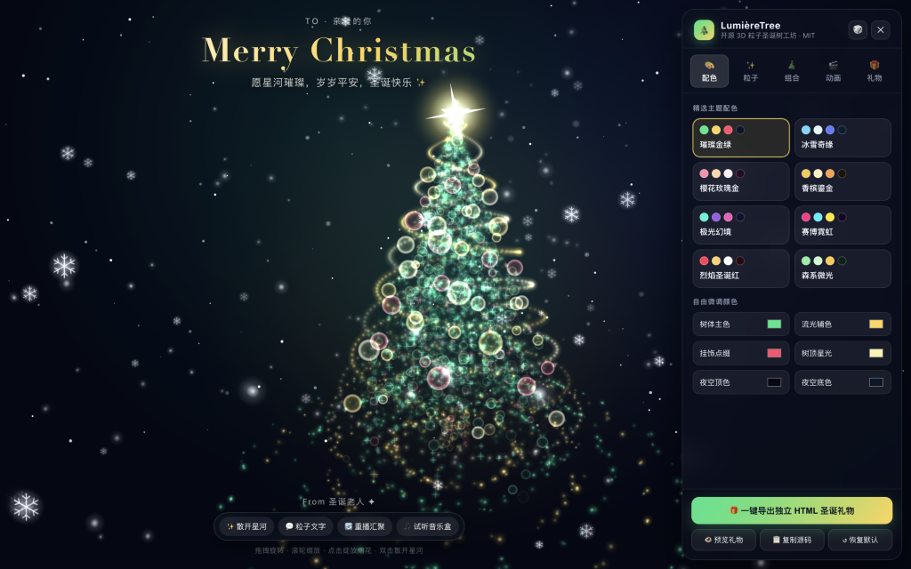
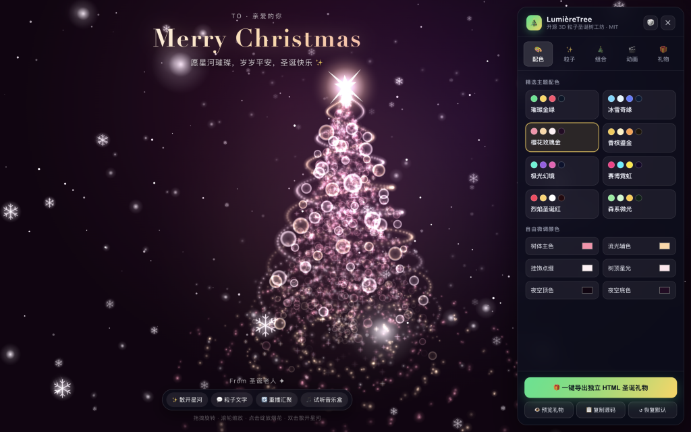
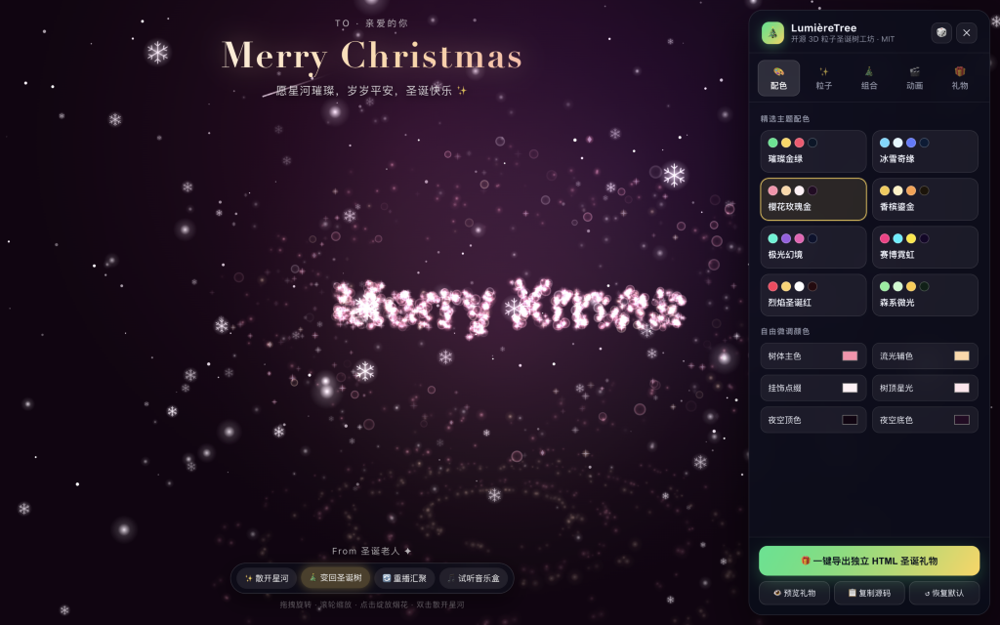

# 🎄 LumièreTree — 开源 3D 粒子圣诞树工坊

> 免费、开源、无需关注付费！自定义你的专属 3D 发光粒子圣诞树，一键导出**零外部依赖、离线可打开**的独立 HTML 圣诞礼物文件，或生成专属分享链接直接发给 TA。

## 📸 效果预览

| 璀璨金绿 · 经典圣诞 | 樱花玫瑰金 · 浪漫粉金 |
| :---: | :---: |
|  |  |

| 3D 粒子文字变形 (`Merry Xmas`) | 拆礼盒开场仪式 (点击自动放音乐) |
| :---: | :---: |
|  |  |

## ✨ 核心特性

- **🎨 8 套精选电影感配色 + 自由取色**：璀璨金绿、冰雪奇缘、樱花玫瑰金、香槟鎏金、极光幻境、赛博霓虹、烈焰圣诞红、森系微光，并支持 6 项自定义取色。
- **✨ 7 种粒子形态 & 质感调节**：混合星尘、柔光光球、四芒星辉、梦幻散景、晶钻棱光、冰晶雪花、**浪漫爱心**；支持实时调节粒子密度（1000–5500）、大小、辉光强度（Bloom）、闪烁频率与运动拖尾。
- **🎄 4 种树体结构 + 4 种树顶造型 + 8 项自由组合特效**：
  - 树体结构：经典分层松塔 / 梦幻螺旋锥 / 双螺旋星链 / 星云漩涡树
  - 树顶造型：⭐ 经典圣星 / 💖 璀璨爱心 / ❄️ 冰晶雪花 / 👑 星耀皇冠
  - 可自由开关：双螺旋流光丝带、树顶造型、流光挂饰球、3D 立体飘雪、地面星河涟漪、许愿流星、极光夜幕、点击绽放烟花
  - 可选**悬浮记忆相框**：上传最多 6 张照片自动压缩并内嵌进导出的单文件 HTML 中。
- **💬 3D 粒子文字变形 + 星河散开交互**：支持将整棵圣诞树丝滑变形为任意自定义 3D 发光文字（如 `Merry Xmas`、对方名字、`I ♥ U`、`2027`）或漫天星河，并随时变回圣诞树。
- **🎁 拆礼盒开场仪式 + 🎵 音乐节拍实时律动**：
  - 打开礼物先展示发光圣诞礼盒卡片，点击后绽放烟花、星海汇聚成树，并顺理成章自动播放内置离线 Web Audio 八音盒（《铃儿响叮当》《祝你圣诞快乐》《平安夜》）。
  - 树体辉光、圣星与地面星河涟漪会随每个音符实时脉动！
- **📤 多格式分享与导出**：
  - **一键导出独立 HTML 礼物**：~73 KB、100% 离线自包含、零 CDN 依赖。
  - **专属分享链接（URL Hash）**：部署到 GitHub Pages 后，直接复制链接发微信，点开即见拆礼盒仪式！
  - **高清海报 PNG / 8 秒循环视频 WebM**：一键保存发朋友圈、抖音、小红书。

## 🚀 快速使用

### 方式一：本地直接打开（零构建）
克隆仓库后直接双击打开 `index.html` 即可开始创作和导出（完全兼容 `file://` 协议）。

### 方式二：一键部署到 GitHub Pages
1. 将本仓库推送到 GitHub。
2. 打开仓库的 **Settings → Pages**。
3. Source 选择 `Deploy from a branch`，分支选择 `main` / `/ (root)`，保存即可获得在线访问地址与 URL 分享功能。

## 📄 开源协议

本项目基于 [MIT License](LICENSE) 开源，欢迎 Star、Fork 与二次创作，让圣诞礼物回归纯粹的心意 ✨

## 🧭 图标来源

品牌与界面图标基于 [Tabler Icons](https://github.com/tabler/tabler-icons) 的 SVG 路径定制，同样采用 MIT 协议。图标直接内联或随项目本地分发，无 CDN 依赖；完整许可声明见 [assets/tabler-LICENSE.txt](assets/tabler-LICENSE.txt)。
